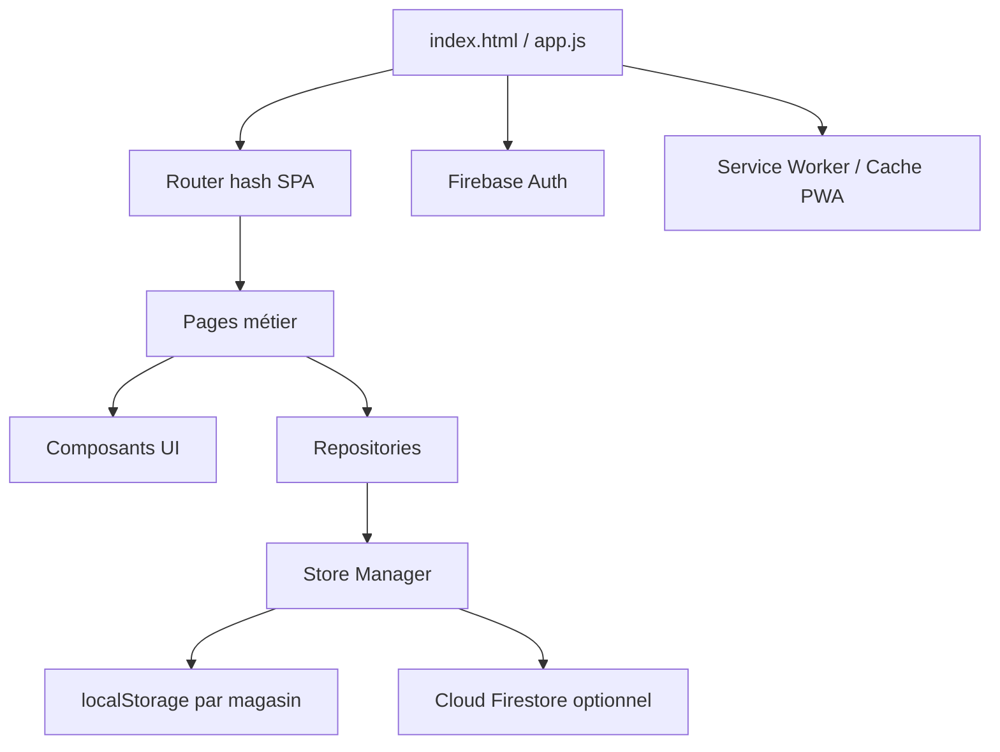
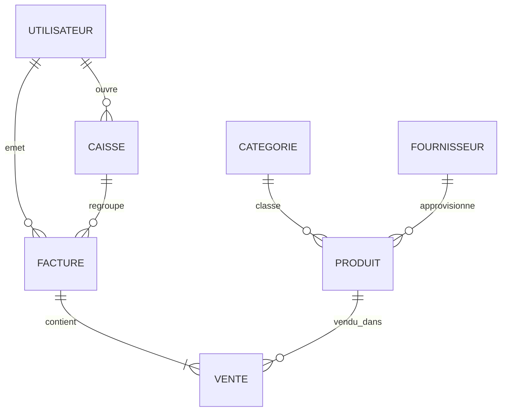
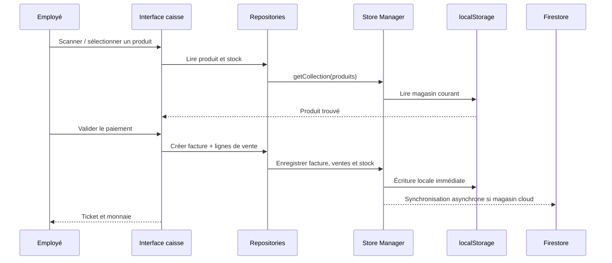

# Rapport d’architecture — Caisse 2.0

## 1. Vue d’ensemble

**Caisse 2.0** est une application de point de vente (POS) livrée comme une application web installable de type PWA. Elle fonctionne principalement côté navigateur et propose un mode hors ligne grâce à `localStorage`, avec une synchronisation distante optionnelle via Firebase/Cloud Firestore.

Caractéristiques principales :

- application monopage (SPA) naviguée par ancres `#/...` ;
- interface générée dynamiquement en JavaScript natif et HTML template literals ;
- stockage local séparé par magasin (`storeId`) ;
- synchronisation Firestore pour les magasins liés à un compte Google ;
- authentification propriétaire par Google et authentification opérationnelle des employés par identifiant/mot de passe ;
- gestion de caisse, ventes, factures, stock, fournisseurs, employés, paramètres et licence ;
- mode clavier/code-barres et mode tactile ;
- impression de tickets et rapport de clôture ;
- service worker, cache statique, manifest PWA et fonctionnement dégradé hors ligne.

## 2. Structure du projet

```text
web/
├── index.html                 Point d’entrée HTML
├── manifest.json              Métadonnées PWA
├── sw.js                      Service worker et cache hors ligne
├── package.json               Dépendance Firebase
├── firestore.rules            Règles Firestore
├── database.rules.json        Règles Firebase Realtime Database pour les licences
├── css/
│   ├── index.css              Design system, layout, responsive, thèmes
│   └── print.css              Styles d’impression
├── js/
│   ├── app.js                 Bootstrap de l’application
│   ├── auth.js                Authentification et session employé
│   ├── firebase-config.js     Initialisation Firebase
│   ├── router.js              Routage SPA et gardes d’accès
│   ├── components/            Composants d’interface réutilisables
│   ├── db/
│   │   ├── store-manager.js   Couche de persistance local/cloud
│   │   └── repositories/      Accès métier aux données
│   ├── helpers/               Fonctions utilitaires
│   └── pages/                 Écrans de l’application
└── assets/                    Ressources statiques complémentaires
```

## 3. Architecture applicative

L’architecture est organisée en couches légères :



### 3.1 Démarrage

Le bootstrap de `js/app.js` effectue les opérations suivantes :

1. enregistrement du service worker ;
2. initialisation du magasin local par défaut et chargement des données d’amorçage ;
3. application du thème ;
4. chargement dynamique des modules Firebase depuis `gstatic.com` ;
5. initialisation Firestore, Auth et Realtime Database lorsque le CDN est disponible ;
6. restauration éventuelle de l’utilisateur Google et création/mise à jour du propriétaire ;
7. vérification de la licence ;
8. démarrage du routeur après suppression de l’écran splash.

### 3.2 Routage et contrôle d’accès

Le routeur est basé sur `window.location.hash`. Chaque route possède une fonction de rendu, un indicateur d’authentification et éventuellement un niveau minimal de rôle.

| Route | Écran | Accès minimal |
|---|---|---|
| `#/inscription` | Connexion Google / inscription | Public |
| `#/login` | Connexion employé locale | Public |
| `#/set-password` | Création des identifiants du propriétaire | Authentifié, rôle 3 |
| `#/caisse-open` | Ouverture de caisse | Authentifié, rôles 1–2 |
| `#/caisse` | Caisse clavier/code-barres | Authentifié, rôle 1+ |
| `#/caisse-touch` | Caisse tactile | Authentifié, rôle 1+ |
| `#/factures` | Historique des factures | Authentifié, rôle 1+ |
| `#/modifier-facture` | Modification d’une facture | Authentifié, rôle 1+ |
| `#/produits` | Articles, catégories et stock | Authentifié, rôle 2+ |
| `#/fournisseurs` | Gestion fournisseurs | Authentifié, rôle 2+ |
| `#/employes` | Employés et audit des sessions | Authentifié, rôle 3 |
| `#/parametres` | Paramètres, licence et clôture | Authentifié, rôle 3 |

Les niveaux de rôle sont :

- **1 — Caissier** : vente et accès opérationnel à la caisse ;
- **2 — Gérant** : caisse, factures, articles/stock et fournisseurs ;
- **3 — Administrateur** : accès total, employés, paramètres et licence.

Le routeur contrôle également l’obligation de définir le premier mot de passe, l’état de la licence et la redirection vers l’ouverture de caisse.

## 4. Interface utilisateur

### 4.1 Shell de l’application

Les écrans protégés sont enveloppés par `components/sidebar.js`, qui fournit :

- barre latérale responsive ;
- identité et rôle de l’employé connecté ;
- navigation conditionnelle selon le rôle ;
- bouton de déconnexion ;
- bascule du thème clair/sombre ;
- titre de page et zone de contenu ;
- indicateur de connexion/synchronisation.

Les écrans d’authentification et d’ouverture de caisse sont des écrans « bare », sans barre latérale.

### 4.2 Écrans fonctionnels

#### Authentification

- **Connexion locale** : nom d’utilisateur, mot de passe et pavé numérique virtuel optionnel.
- **Inscription Google** : authentification Firebase Google, création du propriétaire et initialisation d’un nouveau magasin.
- **Première connexion** : le propriétaire définit son nom d’utilisateur et un mot de passe local.

#### Caisse

Les deux interfaces de caisse partagent les mêmes repositories :

- **mode clavier** : saisie code-barres, recherche, caméra/scanner, panier et raccourcis clavier ;
- **mode tactile** : grille de produits adaptée à l’utilisation tactile ;
- ajout/modification des lignes du panier ;
- remise ;
- calcul du total en millimes ;
- panneau de règlement en espèces avec montants rapides ;
- calcul de la monnaie ;
- validation du ticket ;
- impression du ticket ;
- décrémentation du stock.

#### Ouverture et clôture de caisse

L’ouverture enregistre le fond de caisse initial et crée une session liée au caissier. La clôture enregistre l’heure de fermeture et le montant total. Les factures sont rattachées à la session afin de permettre l’audit par employé.

#### Factures

L’écran des factures propose :

- filtres toutes / aujourd’hui / mois / année ;
- chiffre d’affaires total ;
- bénéfice net estimé ;
- nombre de factures ;
- réimpression ;
- modification ;
- annulation avec restitution du stock.

#### Articles et stock

L’écran produit gère les articles, le code-barres, les prix, les quantités, les seuils minimum, la catégorie, le fournisseur, la date d’expiration et l’image. Il permet aussi de gérer les catégories et de repérer les stocks faibles ou produits proches de l’expiration.

#### Fournisseurs

Répertoire des fournisseurs avec raison sociale, type de produits, adresse, téléphone et jour de passage. L’écran affiche les livraisons prévues le lendemain.

#### Employés

L’administrateur peut créer, modifier et supprimer les employés, choisir leur rôle, gérer leurs mots de passe et consulter les sessions de caisse ainsi que les factures d’une session.

#### Paramètres

Les paramètres couvrent l’identité du magasin, le thème, l’affichage de la caisse, les remises, le PIN, l’activation de la licence et le rapport Z de clôture.

### 4.3 Composants réutilisables

Les composants centraux sont : grille de données, modales de confirmation, toasts, pavé numérique, champ de saisie, panneau de paiement, indicateur en ligne, sidebar et imprimante de ticket. Les helpers prennent en charge les montants, dates, mots de passe, images, thèmes, scan code-barres et impression.

## 5. Architecture de données

### 5.1 Stratégie de persistance

`store-manager.js` est la porte d’entrée unique de la persistance :

- les données locales sont stockées dans `localStorage` ;
- chaque clé suit le format `caisse_2_0_<storeId>_<collection>` ;
- le magasin initial est `default_store` ;
- un magasin Google utilise l’UID Google comme `storeId` ;
- les écritures locales sont immédiates ;
- pour un magasin cloud, une écriture Firestore est déclenchée en arrière-plan ;
- au chargement d’un magasin cloud, Firestore est recopié dans le stockage local ;
- Firestore utilise actuellement un document par collection sous `stores/{storeId}/collections/{collectionName}`.

Le fonctionnement est donc **offline-first**, mais la synchronisation n’est pas un moteur de réplication transactionnel : il s’agit d’un remplacement de document complet et les conflits entre plusieurs clients ne sont pas résolus explicitement.

### 5.2 Modèle logique des données

Les montants monétaires sont généralement stockés en **millimes** (entiers). Par exemple, `2000` représente `2.000 DT`.

#### `config`

Document local contenant trois sous-documents :

- `parametres` : `nom_ste`, `desc_ste`, `adr_ste`, `tel_ste`, `remise`, `img_para`, `caisse_para`, `touch_cols`, `theme` ;
- `pin` : `pin_user` ;
- `licence` : `num_serie`, `validation`, `active` éventuel, `date_debut`, `date_fin`.

#### `utilisateurs`

Employés et propriétaire :

`cin`, `username`, `nom`, `prenom`, `email`, `motpass`, `date_ness`, `adresse`, `num_tel`, `role`, `is_owner`, `provider`, `mustSetPassword`, `passwordConfigured`, `createdAt`.

Le mot de passe est hashé par le repository lorsqu’il est fourni en clair. Le propriétaire Google est identifié par son UID Firebase stocké dans `cin`.

#### `categories`

`id`, `nom_cat`.

#### `produits`

`id`, `code_barre`, `nom_p`, `prix_p`, `prix_achat`, `quantite_p`, `quantite_min`, `rayon`, `date_exp`, `fournisseur`, `categorie`, `lien_img`.

`rayon = 1` correspond à un article vendu à l’unité ; `rayon = 2` correspond à un article vendu au poids.

#### `fournisseurs`

`id`, `nom_prenom`, `produit`, `adresse`, `num_tel`, `date_tour`.

#### `caisses`

Une session de caisse contient :

`id_caisse`, `caissier`, `date_caisse`, `heur_depart`, `heur_fermeture`, `montant_depart`, `montant_total`, `authentification_at`, `deconnexion_at`.

#### `factures`

Une facture contient :

`id_fac`, `date_fac`, `temp_fac`, `cin_user`, `id_caisse_fac`, `prix_tt`, `remise`, `recue`.

#### `ventes`

Une ligne de facture contient :

`id_vt`, `code_barre_vt`, `nom_vt`, `prix_vt`, `quantite_vt`, `prix_tt`, `date_vt`, `rayon`, `prix_achat`, `pr2`, `facture`, `remise`, `modifier`.

### 5.3 Relations métier



Les relations sont implémentées par identifiants ou valeurs texte plutôt que par contraintes de clé étrangère : `facture` référence `factures.id_fac`, `id_caisse_fac` référence `caisses.id_caisse`, `cin_user`/`caissier` référence `utilisateurs.cin`, tandis que `categorie` et `fournisseur` sont actuellement stockés dans le produit sous forme de libellés.

## 6. Repositories et règles métier

Les repositories isolent les opérations de lecture/écriture et normalisent les données :

- `produit-repo.js` : recherche par code-barres, CRUD article, stock faible, expiration et mise à jour du stock ;
- `vente-repo.js` : CRUD des lignes et suppression par facture ;
- `facture-repo.js` : création, modification, recherche par session et annulation ; l’annulation restitue le stock ;
- `caisse-repo.js` : ouverture, déconnexion, fermeture et historique des sessions ;
- `utilisateur-repo.js` : authentification, hash de mot de passe, propriétaire Google, CRUD employés ;
- `fournisseur-repo.js` : CRUD et recherche par jour de livraison ;
- `categorie-repo.js` : CRUD et unicité du nom ;
- `settings-repo.js` : paramètres, PIN et licence.

La logique métier reste toutefois majoritairement dans les pages de caisse et les repositories, sans couche service/domain séparée. La validation est donc principalement côté client.

## 7. Sécurité et autorisations

### Firebase

Les règles Firestore autorisent la lecture et l’écriture uniquement si l’utilisateur authentifié possède un UID égal au `storeId` :

```text
stores/{storeId}/collections/{collectionName}
allow read, write: if request.auth != null && request.auth.uid == storeId;
```

La Realtime Database expose la lecture publique de `licences/{code}` et interdit l’écriture côté client selon `database.rules.json`.

### Côté application

Le routeur applique les gardes de session et de rôle. La session employé est conservée en mémoire JavaScript et n’est donc pas persistante après un rechargement complet. Le PIN et certaines données de configuration sont enregistrés côté client.

### Points de sécurité à surveiller

- la configuration Firebase est incluse dans le frontend ; les règles Firebase doivent donc être la vraie barrière d’accès ;
- les règles Firestore autorisent le propriétaire à écrire tout le document de collection, sans validation de schéma ni séparation fine des actions ;
- les mots de passe historiques peuvent encore être comparés en clair comme mécanisme de compatibilité ;
- le PIN et la licence locale ne constituent pas une protection forte contre un utilisateur maîtrisant le navigateur ;
- la synchronisation complète d’une collection peut provoquer des écrasements en cas d’utilisations simultanées ;
- le CDN Firebase et ZXing sont des dépendances runtime importantes du mode en ligne.

## 8. Déploiement et fonctionnement hors ligne

Le projet est statique et peut être servi par un serveur web simple ou déployé sur Vercel. Le service worker met en cache les ressources statiques et utilise :

- cache-first pour les ressources de l’application ;
- network-first pour Firebase et les appels réseau associés ;
- repli vers `index.html` pour les navigations document hors ligne.

Le manifest configure une installation standalone, les icônes, l’orientation libre et les couleurs de l’application.

Limite importante : la liste actuelle du cache initial du service worker contient surtout les fichiers d’entrée et les styles ; les modules JavaScript secondaires peuvent être mis en cache après leur première requête, mais ne sont pas tous garantis disponibles lors d’un premier démarrage totalement hors ligne.

## 9. Parcours métier principal



## 10. Évaluation synthétique

### Forces

- architecture simple à déployer et à maintenir pour un frontend statique ;
- séparation claire entre pages, composants, helpers et repositories ;
- fonctionnement local rapide et utilisable sans connexion ;
- prise en charge de plusieurs modes de caisse ;
- règles de rôle centralisées dans le routeur ;
- données monétaires stockées en entiers de millimes, ce qui limite les erreurs d’arrondi.

### Risques et améliorations recommandées

1. Ajouter une couche de services transactionnels pour valider atomiquement paiement, facture, lignes et stock.
2. Remplacer les relations texte `categorie`/`fournisseur` par des identifiants stables.
3. Ajouter des timestamps, une version de document et une stratégie de résolution de conflits Firestore.
4. Renforcer les règles Firestore avec validation de structure, contrôle des champs et séparation par rôle.
5. Déplacer les opérations sensibles — licence, clôture, calculs d’audit — vers un backend de confiance.
6. Supprimer le fallback de mot de passe en clair après migration complète des utilisateurs historiques.
7. Ajouter des tests automatisés sur les repositories, le calcul des montants, les remises, le stock au poids et l’annulation de facture.
8. Prévoir une migration de schéma versionnée pour les données présentes dans `localStorage`.
9. Élargir le precache du service worker ou générer automatiquement la liste des modules nécessaires au démarrage hors ligne.
10. Harmoniser les versions Firebase : le `package.json` déclare Firebase `^13.1.0`, tandis que `app.js` charge actuellement les modules Firebase `10.14.1` depuis le CDN.

## 11. Fichiers de référence

- [`index.html`](./index.html) — point d’entrée et métadonnées HTML ;
- [`js/app.js`](./js/app.js) — bootstrap ;
- [`js/router.js`](./js/router.js) — routes et guards ;
- [`js/db/store-manager.js`](./js/db/store-manager.js) — persistance local/cloud ;
- [`js/db/repositories/`](./js/db/repositories/) — accès aux données ;
- [`js/pages/`](./js/pages/) — écrans fonctionnels ;
- [`js/components/`](./js/components/) — composants UI ;
- [`firestore.rules`](./firestore.rules) — autorisations Firestore ;
- [`database.rules.json`](./database.rules.json) — règles Realtime Database ;
- [`sw.js`](./sw.js) — stratégie PWA et cache ;
- [`manifest.json`](./manifest.json) — configuration installable.

---

**Conclusion :** l’application est un POS frontend offline-first, organisé en SPA native avec une persistance locale par magasin et une réplication Firestore facultative. Elle couvre le cycle complet d’une vente, mais les aspects multi-utilisateur, transactionnels et de sécurité forte nécessitent encore une consolidation côté backend.
